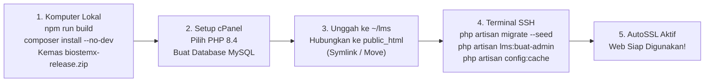

# Panduan Deploy Langsung ke Domain Utama (cPanel & SSH)

Panduan praktis deployment aplikasi **LMS BioSTEMX** langsung ke domain utama (**tanpa subdomain staging**) pada shared hosting cPanel:
- **Paket Hosting**: 2 GB SSD Storage, Akses SSH & Terminal cPanel, PHP 8.4 via PHP Selector, Free SSL (AutoSSL), MySQL.
- **Teknologi**: Laravel 13, MySQL/MariaDB, Blade + Tailwind CSS + Alpine.js.

---

## Ringkasan Alur Kerja



---

## Langkah 1: Persiapan Paket Rilis di Komputer Lokal

Jalankan perintah berikut di PowerShell komputer lokal Anda:

```powershell
# 1. Pastikan seluruh tes logika lulus 100%
php artisan test

# 2. Kompilasi aset frontend produksi (Tailwind, SweetAlert2, PDF viewer)
npm run build

# 3. Optimasi dependensi Composer (hanya dependensi produksi tanpa dev)
composer install --no-dev --optimize-autoloader

# 4. Kemas seluruh berkas rilis ke dalam arsip zip bersih
Compress-Archive -Path app, bootstrap, config, database, lang, public, resources, routes, storage, vendor, artisan, composer.json, composer.lock -DestinationPath biostemx-release.zip -Force
```

> [!TIP]
> Setelah berkas `biostemx-release.zip` selesai dibuat, Anda bisa mengembalikan paket pengembang di lokal kapan saja dengan perintah:
> `composer install`

---

## Langkah 2: Konfigurasi cPanel (PHP 8.4 & MySQL)

Masuk ke dashboard cPanel hosting Anda:

### 1. Pilih Versi PHP 8.4
1. Buka menu **Select PHP Version** (atau **PHP Selector**).
2. Pilih versi **PHP 8.4** dan klik **Set as current**.
3. Buka tab **Extensions**, pastikan ekstensi berikut tercentang aktif:
   - `pdo_mysql`, `mbstring`, `openssl`, `tokenizer`, `xml`, `ctype`, `json`, `bcmath`, `fileinfo`, `gd`, `zip`, `intl`.

### 2. Buat Basis Data MySQL
1. Buka menu **MySQL Databases**.
2. Buat database baru (contoh: `userhost_biostemx`).
3. Buat pengguna database baru (contoh: `userhost_lmsuser`) dengan kata sandi yang kuat.
4. Tambahkan pengguna ke basis data dengan mencentang **ALL PRIVILEGES**.
5. Catat nama database, username, dan kata sandi tersebut.

---

## Langkah 3: Unggah Berkas & Hubungkan ke Domain Utama

### 1. Unggah dan Ekstrak Aplikasi
1. Buka **File Manager** cPanel (atau gunakan SFTP/SCP via SSH).
2. Masuk ke direktori utama akun Anda (`/home/username/`).
3. Buat folder baru bernama `lms` di `/home/username/lms` *(di luar folder `public_html` agar kode sumber dan `.env` tidak dapat diakses langsung oleh publik)*.
4. Unggah berkas `biostemx-release.zip` ke dalam folder `/home/username/lms/`, lalu klik **Extract**.

### 2. Hubungkan Domain Utama ke Folder `public` Aplikasi

Pilih salah satu metode berikut (Metode A sangat direkomendasikan):

#### Metode A: Metode Symlink (Rekomendasi — Bersih & Standar Laravel)
Jalankan di Terminal cPanel atau SSH:
```bash
cd ~
# Cadangkan atau hapus folder public_html bawaan cPanel yang masih kosong
rm -rf public_html

# Buat symbolic link dari folder public aplikasi ke public_html
ln -s /home/username/lms/public public_html
```

#### Metode B: Alternatif (Jika Hosting Tidak Mengizinkan Symlink)
1. Pindahkan seluruh isi berkas dari dalam `/home/username/lms/public/` ke `/home/username/public_html/`.
2. Buka berkas `/home/username/public_html/index.php`, sesuaikan baris `require`:
   ```php
   require __DIR__.'/../lms/vendor/autoload.php';
   $app = require_once __DIR__.'/../lms/bootstrap/app.php';
   ```

---

## Langkah 4: Konfigurasi Berkas `.env` di Server

1. Di dalam folder `/home/username/lms/`, buat berkas `.env` (bisa menyalin dari `.env.example`).
2. Isi dan sesuaikan data berikut:

```ini
APP_NAME=BioSTEMX
APP_ENV=production
APP_KEY=  # Dibuat otomatis lewat artisan key:generate
APP_DEBUG=false
APP_URL=https://namadomainanda.com

LOG_CHANNEL=stack
LOG_LEVEL=error

DB_CONNECTION=mysql
DB_HOST=127.0.0.1
DB_PORT=3306
DB_DATABASE=userhost_biostemx
DB_USERNAME=userhost_lmsuser
DB_PASSWORD=KataSandiDatabaseAnda

SESSION_DRIVER=database
SESSION_LIFETIME=120
SESSION_ENCRYPT=false

CACHE_STORE=database
QUEUE_CONNECTION=sync
```

---

## Langkah 5: Eksekusi Perintah Server via SSH

Buka **Terminal** di cPanel atau hubungkan via SSH (PuTTY / Terminal lokal), lalu jalankan perintah berikut secara berurutan:

```bash
# 1. Pindah ke folder aplikasi
cd ~/lms

# 2. Buat APP_KEY baru yang aman
php artisan key:generate --force

# 3. Jalankan migrasi tabel dan seeder data awal
php artisan migrate --force --seed

# 4. Buat akun administrator produksi (Interaktif dengan kata sandi tersembunyi)
php artisan lms:buat-admin

# 5. Optimasi performa cache (Wajib di shared hosting)
php artisan config:cache
php artisan route:cache
php artisan view:cache

# 6. Jalankan diagnosa otomatis untuk memastikan hosting sudah 100% siap
php artisan lms:cek-lingkungan

# 7. Pastikan hak akses folder penyimpanan terbuka untuk PHP
chmod -R 775 storage bootstrap/cache
```

> [!NOTE]
> Perintah `php artisan lms:buat-admin` akan meminta Anda memasukkan nama, username, email, dan kata sandi minimal 12 karakter. Akun ini otomatis diwajibkan mengganti kata sandi pada saat pertama kali login.

---

## Langkah 6: Aktifkan SSL Gratis (HTTPS)

1. Di cPanel, buka menu **SSL/TLS Status**.
2. Centang domain utama Anda (`namadomainanda.com` dan `www.namadomainanda.com`).
3. Klik tombol **Run AutoSSL**.
4. Tunggu 1–2 menit hingga ikon gembok hijau muncul (sertifikat SSL aktif).
5. Buka `https://namadomainanda.com` di browser. Web LMS BioSTEMX siap digunakan!

---

## 7. Jalur Cadangan (Bila Sewaktu-waktu Terkendala Akses SSH)

Jika Anda tidak dapat mengakses terminal SSH:
1. **Impor Skema**: Buka phpMyAdmin di cPanel > pilih database Anda > tab **Import** > unggah berkas `database/skema-awal.sql`.
2. **Buat Admin via SQL**: Jalankan di komputer lokal:
   ```bash
   php artisan lms:cetak-sql-admin --nama="Irma Pengelola" --username="admin_irma" --email="admin@sekolah.sch.id"
   ```
   Salin baris `INSERT INTO users ...` yang dicetak di terminal lokal, lalu tempel dan jalankan di tab **SQL** phpMyAdmin hosting Anda.
